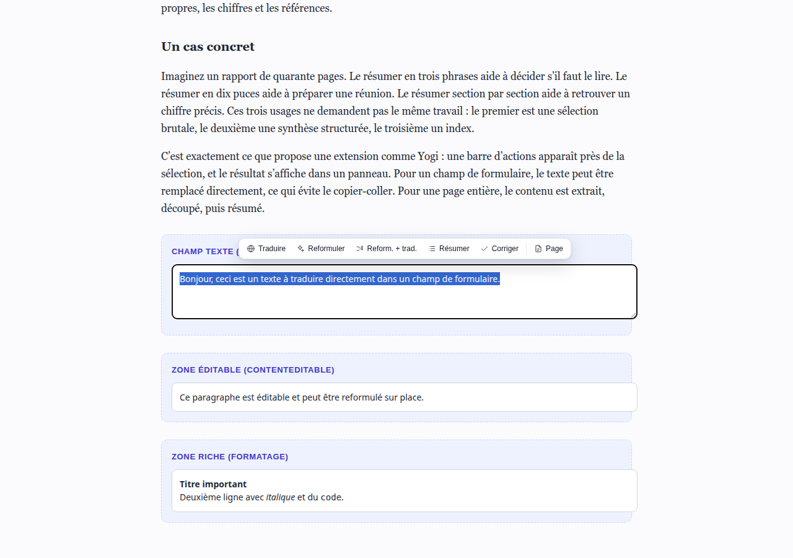
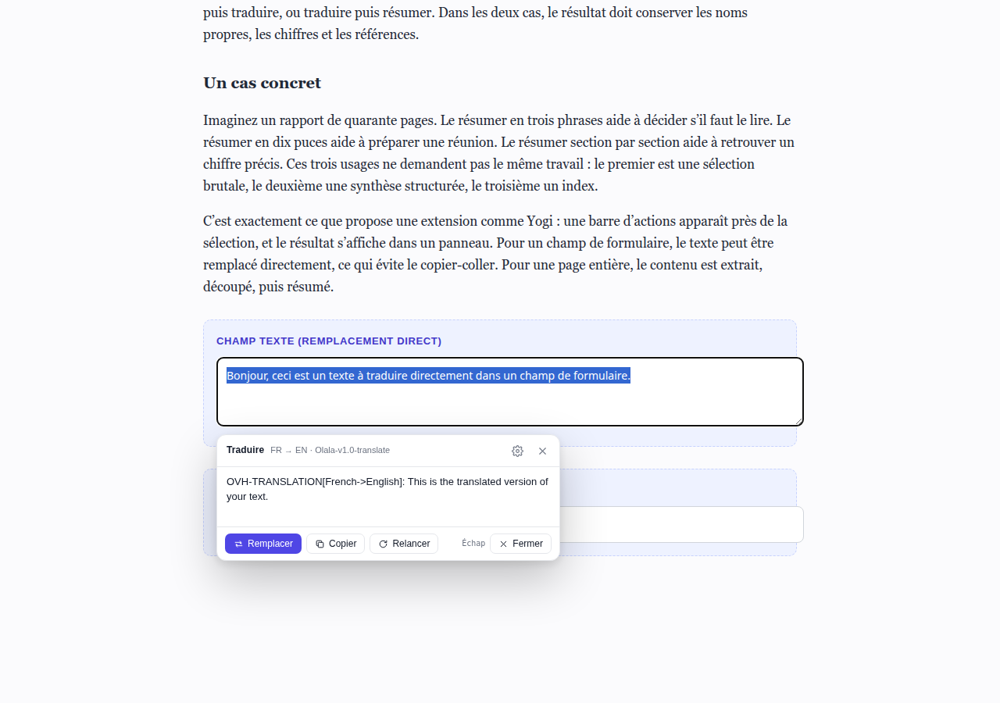
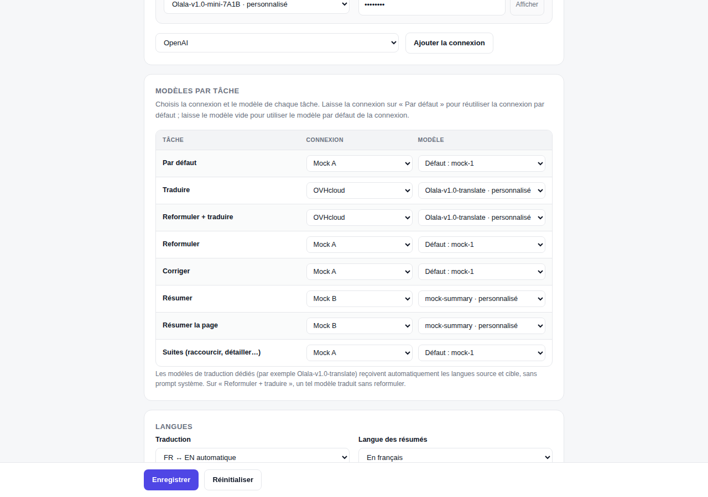
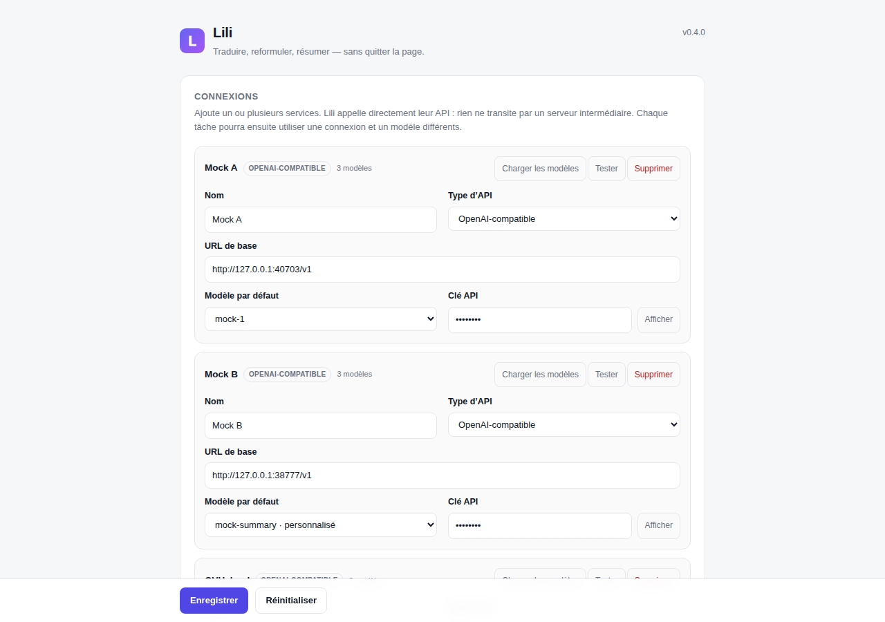
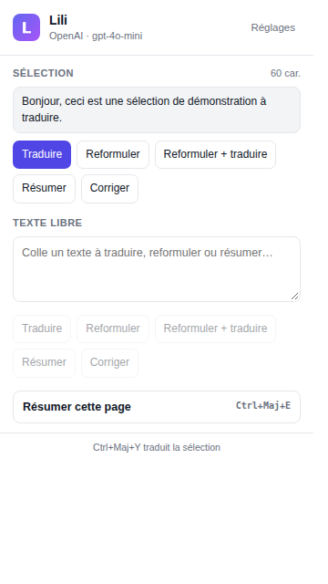
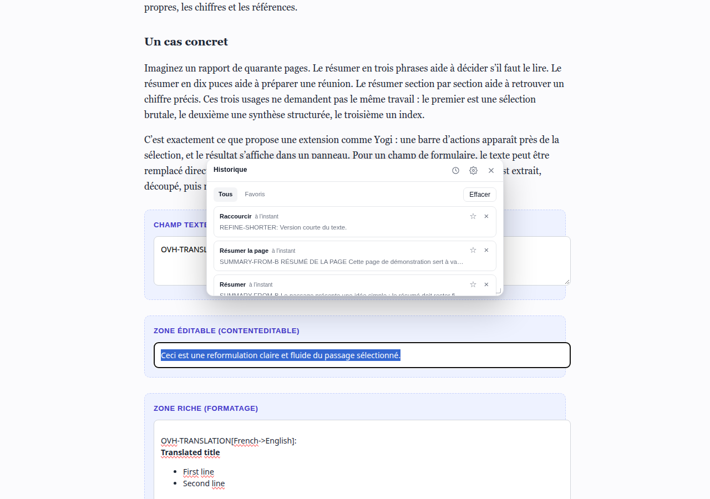
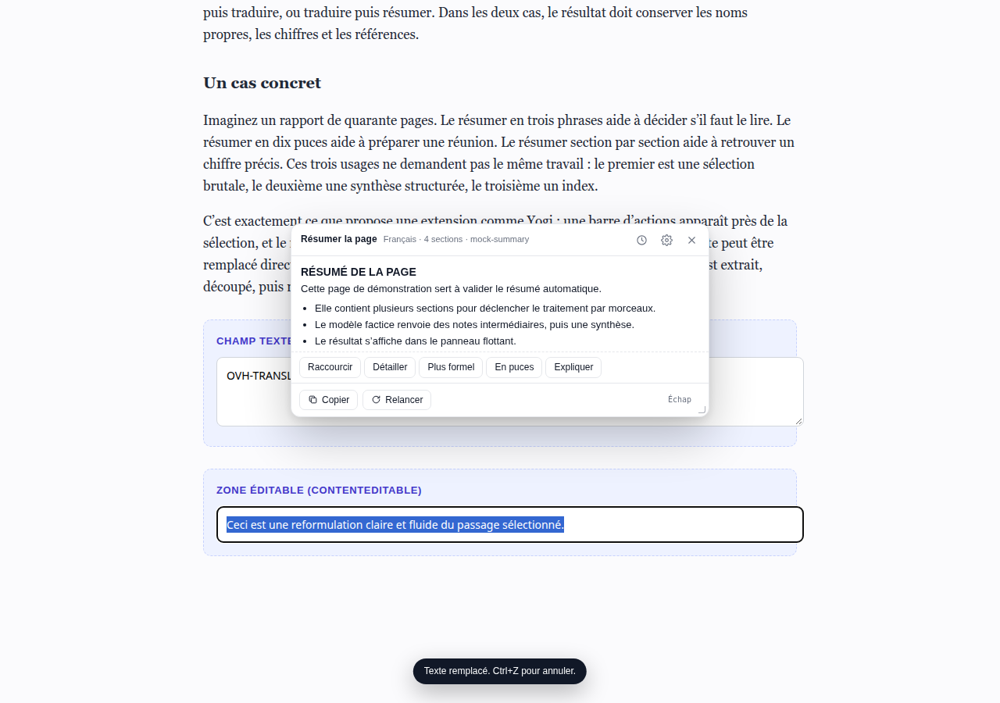

# Lili

[English](README.md) · **Français**

Lili est une extension pour Chrome et Firefox qui traite du texte sans quitter la page : traduire,
reformuler, reformuler puis traduire, résumer une sélection, corriger un texte, ou résumer une page
entière.

Chaque tâche peut utiliser sa propre connexion et son propre modèle — par exemple OVHcloud Olala
pour la traduction et les résumés, OpenRouter pour choisir un modèle par usage, OpenCode Zen ou Go,
OpenAI, Anthropic, ou une instance Ollama locale. Les requêtes partent directement du navigateur
vers l’API choisie : aucun serveur intermédiaire n’est impliqué.



## Fonctionnalités

| Action | Sur une sélection | Dans un champ texte | Raccourci |
| --- | --- | --- | --- |
| Traduire (FR ↔ EN automatique) | oui | **remplace sur place** | `Ctrl+Maj+Y` |
| Reformuler (ton réglable) | oui | **remplace sur place** | `Ctrl+Maj+U` |
| Reformuler puis traduire | oui | **remplace sur place** | — |
| Résumer | oui | panneau de résultat | `Ctrl+Maj+H` |
| Corriger l’orthographe et la grammaire | oui | **remplace sur place** | — |
| Résumer la page entière | — | — | `Ctrl+Maj+E` |

- **Barre flottante** près de la sélection, **menu contextuel** (clic droit), **popup** (sélection
  courante, texte collé ou page entière) et **raccourcis clavier**.
- **Réponse en streaming** dans un panneau compact construit dans un shadow root : les styles de la
  page ne peuvent pas interférer.
- **Actions de suivi** sur chaque résultat (raccourcir, détailler, plus formel, en puces, expliquer),
  avec un retour en un clic au résultat précédent.
- **Arrêt** d’une génération en cours, en conservant la réponse partielle.
- **Diff avant/après** avant de remplacer une sélection, avec confirmation explicite.
- **Mode direct** pour les champs éditables : remplacement sans ouvrir le panneau.
- **Contexte optionnel** : envoi du paragraphe englobant pour une meilleure cohérence (désactivé par
  défaut).
- **Historique local** avec favoris, restauration en un clic et effacement. Les entrées restent dans
  le profil du navigateur.
- **Règles par site** : désactiver la barre flottante sur certains domaines et forcer une langue
  cible (`domaine = fr`).
- **Rendu Markdown léger** des résultats : titres, listes, gras/italique, code inline et citations.
  Copier et Remplacer utilisent toujours le texte brut ; le rendu peut être désactivé dans les
  réglages.
- **Remplacement sur place** dans les champs `input`, `textarea` et `contenteditable`, avec annulation
  (`Ctrl+Z` / `Cmd+Z`) et un mode de remplacement automatique optionnel.
- **Conservation du formatage** : les sélections riches sont capturées en Markdown (retours à la
  ligne, gras/italique, listes, titres), envoyées avec une consigne de formatage et rendues en
  Markdown. Le remplacement dans un `contenteditable` insère du HTML formaté ; les champs simples
  reçoivent du texte brut.
- **Résumé de page en map-reduce** : le contenu principal est extrait, découpé en sections, résumé
  section par section, puis fusionné. Les pages longues ne sont pas tronquées silencieusement.
- **Routage par tâche** : une connexion et un modèle par action, avec une connexion de repli.
- **Listes de modèles automatiques**, récupérées auprès de chaque fournisseur, mises en cache sept
  jours et rafraîchissables manuellement.
- **Détection de langue FR/EN** pour la traduction automatique, ou langue cible fixe.
- Le panneau de résultat se **déplace** par son en-tête et se **redimensionne** par la poignée en bas
  à droite.

| Panneau de résultat | Routage par tâche |
| --- | --- |
|  |  |

| Connexions | Popup |
| --- | --- |
|  |  |

Historique local, accessible par l’icône horloge du panneau de résultat :



Les résumés de page sont rendus avec un Markdown léger :



## Installation

### Chrome, Edge et Brave (116+)

1. Téléchargez `lili-chrome.zip` depuis la page Releases de ce dépôt et décompressez-le.
2. Ouvrez `chrome://extensions` et activez le **Mode développeur**.
3. Cliquez sur **Charger l’extension non empaquetée** et sélectionnez le dossier décompressé.
4. Épinglez l’extension, puis ouvrez les **Options** (clic droit sur l’icône → Options).

### Firefox (142+)

1. Téléchargez `lili-firefox.zip` depuis la page Releases et décompressez-le.
2. Ouvrez `about:debugging#/runtime/this-firefox`.
3. Cliquez sur **Charger un module temporaire** et sélectionnez `manifest.json` dans le dossier
   décompressé.

Un module temporaire est retiré au redémarrage de Firefox. Pour une installation permanente, le
paquet doit être signé par Mozilla puis installé via `about:addons`, ou distribué sur
addons.mozilla.org.

## Configuration

Lili sépare **les connexions** (où appeler : type d’API, URL, clé) du **routage** (quel modèle pour
quelle tâche).

### 1. Ajouter des connexions

Ouvrez **Options → Connexions**, choisissez un préréglage et cliquez sur **Ajouter la connexion**.

| Préréglage | URL de base | Modèles (exemples) |
| --- | --- | --- |
| OpenAI | `https://api.openai.com/v1` | `gpt-4o-mini`, … |
| OpenRouter | `https://openrouter.ai/api/v1` | des centaines de modèles (`openai/gpt-4o-mini`, …) |
| OVHcloud AI Endpoints | `https://oai.endpoints.kepler.ai.cloud.ovh.net/v1` | `Olala-v1.0-translate`, `Olala-v1.0-summarise`, … |
| OpenCode Zen | `https://opencode.ai/zen/v1` | `deepseek-v4-flash`, … |
| OpenCode Go | `https://opencode.ai/inference/go/openai/v1` | `kimi-k3`, … |
| Anthropic | `https://api.anthropic.com` | `claude-3-5-haiku-latest`, … |
| Ollama (local) | `http://localhost:11434` | modèles installés |
| Personnalisé | — | Mistral, Groq, vLLM, LiteLLM… |

Pour chaque connexion, renseignez la clé API et le modèle par défaut, puis utilisez **Tester** pour
vérifier l’endpoint. Les listes de modèles sont récupérées automatiquement à l’ouverture des options
(cache de sept jours) et proposées dans des menus déroulants ; **Charger les modèles** force un
rafraîchissement et **Autre modèle…** permet une saisie manuelle. À l’enregistrement, le navigateur
demande l’accès réseau aux hôtes configurés — nécessaire pour contourner les restrictions CORS.

Les listes proviennent de `GET {base}/models` (compatible OpenAI), `GET /v1/models` (Anthropic) et
`GET /api/tags` (Ollama). Les bases OpenCode `/openai/v1` sont converties en `/v1/models`. Si un
fournisseur rejette la clé (401/403) mais expose un catalogue public — c’est le cas d’OVHcloud —
Lili réessaie sans authentification. Les modèles non conversationnels (TTS, Whisper, embeddings,
images) sont filtrés.

### 2. Router les tâches

**Options → Modèles par tâche** associe une connexion et un modèle à chaque action :

| Tâche | Exemple |
| --- | --- |
| Traduction | OVHcloud · `Olala-v1.0-translate` |
| Reformuler puis traduire | OpenRouter · un modèle généraliste |
| Reformulation | OpenRouter · … |
| Correction | … |
| Résumé de sélection | OVHcloud · `Olala-v1.0-summarise` |
| Résumé de page | OVHcloud · `Olala-v1.0-summarise` |
| Suites (raccourcir, détailler…) | un modèle généraliste |

- La ligne **Par défaut** sert de repli quand une tâche ne définit pas de connexion.
- Une tâche laissée sur **Par défaut** utilise la connexion par défaut.
- Un modèle vide utilise le modèle par défaut de la connexion sélectionnée.

### Modèles dédiés

- **`Olala-v1.0-translate`** (OVHcloud) est un modèle de traduction seul. Lili le détecte et envoie
  `source_language` / `target_language` en anglais, sans prompt système. Son contexte de 8k tokens
  limite une sélection à **12 000 caractères** (erreur explicite au-delà). Sur « Reformuler puis
  traduire », il traduit sans reformuler. Aucun prompt système n’étant envoyé, la conservation exacte
  du Markdown dépend de ce modèle ; utilisez un modèle généraliste si le formatage doit être garanti.
- **`Olala-v1.0-summarise`** est un modèle de chat classique avec un contexte large, adapté aux
  résumés de page.
- **OpenCode Zen et Go** utilisent `chat/completions`. Les modèles gratuits réservés au client
  OpenCode renvoient 403 ailleurs ; il faut un modèle payant ou un abonnement Go. L’en-tête de
  session exigé par Go est ajouté automatiquement.
- **OpenRouter** accepte les en-têtes facultatifs `HTTP-Referer` / `X-Title` ; Lili envoie
  `X-Title: Lili`.

### Ollama

Ollama doit autoriser l’origine de l’extension, sinon les requêtes sont rejetées :

```bash
OLLAMA_ORIGINS="*" ollama serve
```

### Réglages

- **Routage** : connexion et modèle par tâche, plus une connexion de repli.
- **Langue cible de traduction** : FR ↔ EN automatique, toujours français, ou toujours anglais.
- **Langue des résumés** : français ou anglais.
- **Ton de la reformulation** : neutre, professionnel, décontracté, académique.
- **Longueur du résumé** : court, moyen, détaillé.
- **Barre flottante** : affichage et choix des actions proposées.
- **Remplacement automatique** : remplace le contenu du champ dès la fin d’une tâche.
- **Mode direct** : remplace un champ sans ouvrir le panneau (pas d’étape de diff).
- **Contexte environnant** : envoie le paragraphe englobant avec la sélection. Désactivé par défaut,
  car cela transmet plus de texte au fournisseur.
- **Sites** : désactiver la barre flottante par domaine et forcer une langue cible
  (`domaine = fr` / `domaine = en`).
- **Markdown** : interpréter les titres, listes et emphases des résultats.
- **Limites** : taille maximale d’une sélection et taille maximale d’une page analysée.

## Utilisation

1. Sélectionnez du texte : la barre apparaît au-dessus de la sélection.
2. Cliquez sur une action, ou faites un clic droit puis choisissez *Traduire / Reformuler / Résumer…*.
3. Le panneau affiche la réponse en streaming :
   - les **suites** affinent le résultat : *Raccourcir*, *Détailler*, *Plus formel*, *En puces*,
     *Expliquer*, avec *Retour* au résultat précédent ;
   - **Remplacer** (champs éditables) ouvre un diff avant/après ; **Confirmer** applique le
     remplacement, `Ctrl+Z` / `Cmd+Z` annule ;
   - **Arrêter** interrompt une génération en cours et conserve le résultat partiel ;
   - **Copier** place le texte brut (sans marqueurs Markdown) dans le presse-papiers ;
   - **Relancer** rejoue la même demande ;
   - l’**icône horloge** ouvre l’historique local : ajouter aux favoris, cliquer une entrée pour la
     restaurer, ou effacer la liste ;
   - la **croix** — ou `Échap` — ferme le panneau.

Faites glisser le panneau par son en-tête pour le déplacer, et redimensionnez-le par la poignée en bas
à droite. La taille choisie est conservée pour les résultats suivants.

Le bouton **Page** de la barre, le popup et `Ctrl+Maj+E` résument la page courante. Le popup permet
aussi de traiter un texte collé.

## Confidentialité

- Le texte sélectionné n’est envoyé qu’au fournisseur configuré pour la tâche, au moment où une
  action est déclenchée.
- Aucune télémétrie, aucun outil de mesure d’audience, aucun compte, aucun serveur exploité par le
  projet.
- Les clés API sont stockées dans `chrome.storage.local` (le profil du navigateur), jamais dans le
  code source.
- Les prompts et les réponses ne sont pas journalisés.
- Le manifeste Firefox déclare la collecte `websiteContent` : le texte traité est transmis au
  fournisseur configuré, et à lui seul.
- Le contexte environnant optionnel transmet également le paragraphe englobant ; il est désactivé
  par défaut.
- L’historique des résultats est stocké localement dans le profil du navigateur (50 entrées hors
  favoris, plus les favoris) et peut être effacé depuis le panneau Historique.

## Limites connues

- Les champs `input` et `contenteditable` situés dans un shadow DOM de la page ne sont pas détectés.
- Les éditeurs sur canvas (Google Docs, certains IDE web) n’exposent pas leur sélection.
- Les iframes ne reçoivent pas la barre flottante ; le menu contextuel fonctionne via le texte
  sélectionné (sans remplacement sur place).
- Les pages internes du navigateur, les visionneuses PDF natives et les boutiques d’extensions ne
  peuvent pas être scriptées.
- La détection de langue est une heuristique FR/EN ; les autres langues nécessitent une cible fixe.
- Les pages très longues sont résumées sur les `maxChunks` premières sections (8 par défaut).
- Les modèles de traduction dédiés (`Olala-v1.0-translate`) acceptent jusqu’à 12 000 caractères par
  sélection.
- Les modèles gratuits OpenCode sont réservés au client OpenCode et renvoient 403 depuis l’extension.

## Dépannage

| Symptôme | À vérifier |
| --- | --- |
| « Accès refusé (401) » | Clé API invalide ou expirée ; vérifiez aussi l’URL de base. |
| « Impossible de joindre l’API » | URL erronée, service arrêté ou autorisation d’hôte refusée : réenregistrez les réglages et acceptez la demande du navigateur. |
| « Endpoint ou modèle introuvable (404) » | Pour les API compatibles OpenAI, l’URL de base se termine généralement par `/v1` ; vérifiez l’identifiant du modèle. |
| Erreur réseau avec Ollama | Relancez Ollama avec `OLLAMA_ORIGINS="*"`. |
| « Aucun modèle défini pour cette tâche » | Renseignez un modèle par défaut sur la connexion ou choisissez un modèle dans le routage. |
| La liste des modèles échoue sur OVHcloud | Le catalogue est public mais refuse les jetons invalides ; Lili réessaie sans clé. Rechargez l’extension si l’erreur persiste. |
| « 400 source_language / target_language » | Un modèle de traduction dédié est utilisé pour une tâche qui n’est pas une traduction. |
| « 403 » avec OpenCode | Les modèles gratuits sont réservés au client OpenCode : utilisez un modèle payant ou Go. |
| Pas de barre sur une page | Page interne du navigateur, PDF, sélection dans une iframe, ou barre désactivée dans les réglages. |
| Rien ne se passe après un rechargement de l’extension | Rechargez l’onglet : les content scripts ne sont pas réinjectés dans les pages déjà ouvertes. |
| Un raccourci clavier ne fait rien | Chrome peut ne pas assigner un raccourci suggéré en cas de conflit. Vérifiez `chrome://extensions/shortcuts` et définissez-le manuellement. `Alt+Maj` est aussi le changement de disposition clavier sur beaucoup de bureaux Linux ; les valeurs par défaut utilisent `Ctrl+Maj` pour cette raison. Les raccourcis sont gérés par la commande du navigateur et par un fallback dans le content script, ce qui les fait fonctionner même si Chrome ne délivre pas la commande. Les pages internes du navigateur n’utilisent que la commande. |

## Développement

Prérequis : Node.js 20.11 ou ultérieur ; Python avec Pillow pour générer les icônes ; le binaire
`zip` pour le packaging ; Chrome pour les tests de bout en bout.

```bash
npm ci                # dépendances de test et de packaging
npm run icons         # régénère les icônes PNG
npm run check         # syntaxe JS/MJS et validation JSON
npm run build         # dist/chrome et dist/firefox
npm run build:zip     # plus dist/lili-chrome.zip et dist/lili-firefox.zip
npm run lint:firefox  # addons-linter, avertissements traités comme des erreurs
npm run verify:version
npm test              # vérifications + tests de bout en bout dans Chrome
```

Les tests de bout en bout nécessitent Chrome :

```bash
npx @puppeteer/browsers install chrome@stable --path .cache/chrome
CHROME_PATH=$(find .cache/chrome -type f -name chrome | head -n 1) npm run test:e2e
```

Le harness démarre deux faux fournisseurs OpenAI, charge l’extension dans Chrome et vérifie le
routage par tâche, la gestion des modèles OVHcloud, le streaming, le remplacement, les résumés, le
popup, ainsi que le déplacement et le redimensionnement du panneau (37 assertions).

Les agents de codage IA trouveront dans [AGENTS.md](AGENTS.md) les invariants, les spécificités des
fournisseurs et des checklists de modification.

Organisation du dépôt :

```
src/
├── manifest.base.json       # manifeste commun
├── manifest.chrome.json     # service worker MV3
├── manifest.firefox.json    # event page, identifiant gecko, collecte de données
├── background.js            # réglages, menus, raccourcis, streaming, prompts, map-reduce
├── shared/constants.js      # métadonnées des actions
├── content/                 # sélection, barre, panneau, extraction, remplacement
├── options/                 # connexions, routage, réglages
└── popup/                   # actions rapides
scripts/
├── build.mjs                # dist/chrome + dist/firefox (+ zip)
├── check.mjs                # vérifications de syntaxe et de JSON
├── verify-version.mjs       # versions package/manifeste/tag
└── make-icons.py            # icônes PNG
test/e2e/                    # harness Chrome, faux fournisseurs, page de démonstration
.github/workflows/           # CI et release
```

Après une modification, lancez `npm run build` puis rechargez l’extension : bouton **Recharger** dans
`chrome://extensions`, ou **Recharger** dans `about:debugging` pour Firefox. Rechargez également les
onglets ouverts.

## CI et release

- `.github/workflows/ci.yml` s’exécute à chaque push sur `dev` et `main`, ainsi que sur les pull
  requests : vérifications statiques, packaging, lint Firefox, puis installation de Chrome for
  Testing et suite de bout en bout. Les paquets et les captures des tests sont publiés en artefacts.
- `.github/workflows/release.yml` s’exécute sur les tags `v*`. Il vérifie que le tag appartient à
  `main` et que `package.json`, `src/manifest.base.json` et le tag partagent la même version, puis
  reconstruit, relance les tests et publie une **GitHub Release** avec `lili-chrome.zip` et
  `lili-firefox.zip`.

### Publier une version

1. Réglez la version dans les deux fichiers et ajoutez la section correspondante dans
   [CHANGELOG.md](CHANGELOG.md) :

```bash
npm run version:set -- 0.3.1
# éditer CHANGELOG.md : déplacer les entrées de Unreleased vers [0.3.1] avec la date
npm run check
```

2. Commitez sur `dev`, fusionnez dans `main`, puis taguez :

```bash
git switch dev
git add -A && git commit -m "🔖 release 0.3.1"
git push
git switch main
git merge dev
git push origin main
git tag v0.3.1
git push origin v0.3.1
```

Le workflow vérifie que le tag appartient à `main`, que la version correspond et que `CHANGELOG.md`
contient une section pour ce tag. Il reconstruit ensuite, lance le lint et la suite de bout en bout,
puis publie une GitHub Release avec :

- `lili-chrome.zip` et `lili-firefox.zip` ;
- `SHA256SUMS`, vérifiable avec `sha256sum -c SHA256SUMS` ;
- les notes de release issues de la section correspondante de `CHANGELOG.md`.

La publication sur le Chrome Web Store et addons.mozilla.org reste manuelle : téléversez les zips de
la release (une XPI signée par Mozilla est nécessaire pour une installation permanente de Firefox).

## Conventions

- Branches : `main` est stable (releases) ; `dev` sert au développement et à l’intégration.
- Les commits suivent **Gitmoji**, avec un sujet à l’impératif en anglais et un corps factuel en
  puces.
- Le code et les commentaires sont en anglais, avec des commentaires courts ; l’interface et les
  prompts sont en français. La documentation est fournie en anglais (`README.md`) et en français
  (`README.fr.md`).

## Licence

Lili est distribué sous **Mozilla Public License 2.0** (`MPL-2.0`). Voir [LICENSE](LICENSE).

En résumé : utilisation, modification et redistribution libres. Le copyleft est **au niveau
fichier** : si un fichier couvert est modifié puis redistribué, sa version modifiée doit rester sous
MPL. Lili peut être combiné avec du code sous d’autres licences, y compris propriétaire. La licence
inclut une concession de brevets et n’accorde aucun droit sur les marques. Le code source
correspondant est ce dépôt, et le fichier de licence est inclus dans les paquets Chrome et Firefox
générés.
