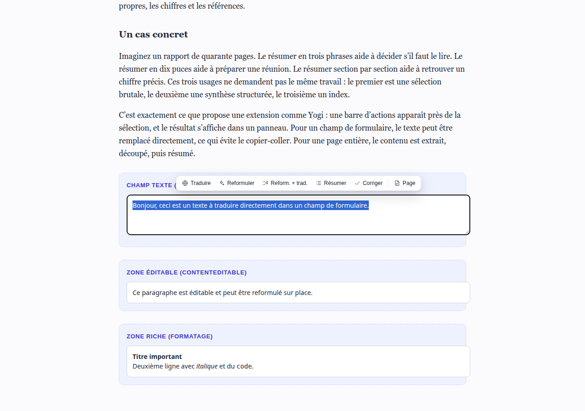
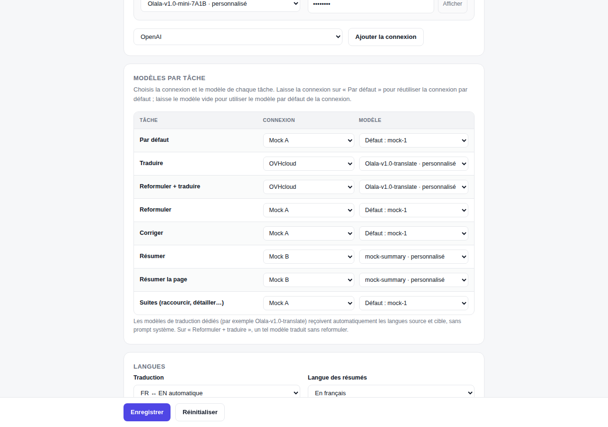
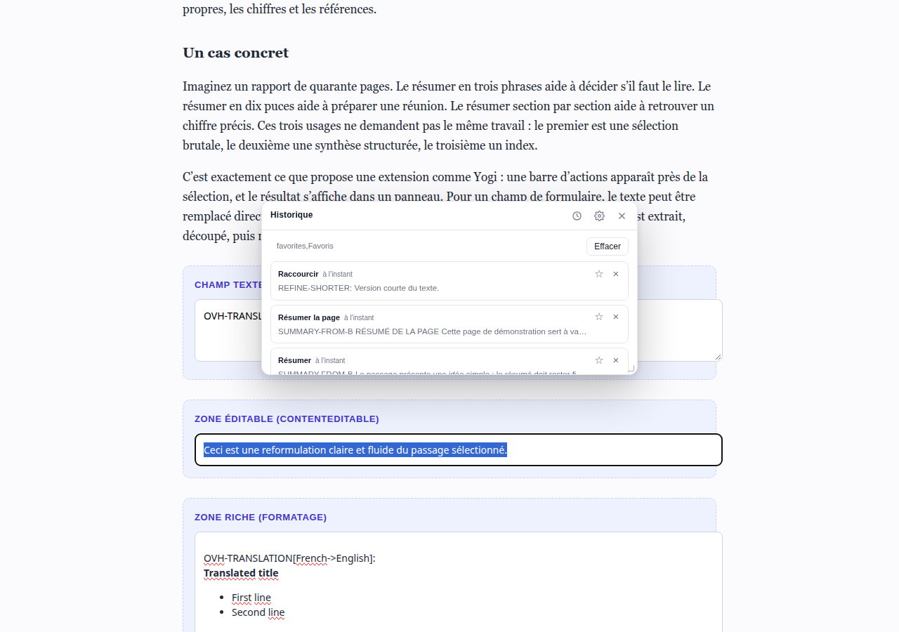

<p align="center"></p>

# Lili

**English** · [Français](README.fr.md)

Lili is a browser extension for Chrome and Firefox that handles text without leaving the page:
translate, rephrase, rewrite and translate, summarize a selection, fix a text, or summarize a whole
page.

Each task can use its own provider and model — for example OVHcloud Olala for translation and
summaries, OpenRouter for a specific model per use case, OpenCode Zen or Go, OpenAI, Anthropic, or a
local Ollama instance. Requests go straight from the browser to the selected API; there is no
intermediate server.



## Features

| Action | On a selection | In a text field | Shortcut |
| --- | --- | --- | --- |
| Translate (FR ↔ EN auto) | yes | **replaces in place** | `Ctrl+Shift+Y` |
| Rephrase (adjustable tone) | yes | **replaces in place** | `Ctrl+Shift+U` |
| Rephrase then translate | yes | **replaces in place** | — |
| Summarize | yes | result panel | `Ctrl+Shift+H` |
| Fix spelling and grammar | yes | **replaces in place** | — |
| Summarize the whole page | — | — | `Ctrl+Shift+E` |

- **Floating toolbar** near the selection, **context menu** (right click), **popup** (current
  selection, pasted text, or whole page) and **keyboard shortcuts**.
- **Streaming output** in a compact result panel built with a shadow root, so page styles never
  interfere.
- **Follow-up actions** on any result (shorten, expand, more formal, bullet points, explain), with a
  one-step back to the previous result.
- **Stop** a running generation and keep the partial answer.
- **Before/after diff** before replacing a selection, with an explicit confirmation.
- **Direct mode** for editable fields: replace the text without opening the result panel.
- **Optional surrounding context**: send the enclosing paragraph with a request for better
  consistency (disabled by default).
- **Local history** with favorites, one-click restore and a clear action. Entries stay in the
  browser profile.
- **Per-site rules**: disable the floating toolbar on chosen domains and force a translation target
  (`domain = fr`).
- **Lightweight Markdown rendering** for results: headings, lists, bold/italic, inline code and
  quotes. Copy strips the Markdown markers; replace inserts the raw text, so Markdown typed in a
  field is preserved. Rendering can be disabled in the settings.
- **In-place replacement** in `input`, `textarea` and `contenteditable` fields, with undo
  (`Ctrl+Z` / `Cmd+Z`) and an optional automatic replacement mode.
- **Formatting preservation**: rich selections are captured as Markdown (line breaks, bold/italic,
  lists, headings), sent with a formatting instruction, and rendered as Markdown. Replacing in a
  rich `contenteditable` inserts formatted HTML; plain fields keep the translated text as-is and a
  Markdown source editor keeps its raw syntax.
- **Page summaries with map-reduce**: the main content is extracted, split into sections, summarized
  section by section, then merged. Long pages are not silently truncated.
- **Per-task routing**: one connection and one model per action, with a fallback connection.
- **Automatic model lists** fetched from each provider, cached for seven days, with a manual refresh.
- **FR/EN language detection** for automatic translation, or a fixed target language.
- **Localized interface** in English and French, following the browser language (English by
  default); generated text follows the language settings.
- Result panel can be **dragged** by its header and **resized** from the bottom-right grip.

| Result panel | Per-task routing |
| --- | --- |
|  |  |

| Connections | Popup |
| --- | --- |
|  |  |

Local history, available from the clock icon in the result panel:



Page summaries are rendered with lightweight Markdown:


> Screenshots show the French interface. The interface follows the browser language (English by
> default, French when the browser is in French); generated text follows the language settings.

## Installation

### Chrome, Edge and Brave (116+)

1. Download `lili-chrome.zip` from the Releases page of this repository and unzip it.
2. Open `chrome://extensions` and enable **Developer mode**.
3. Click **Load unpacked** and select the unzipped folder.
4. Pin the extension, then open **Options** (right click on the icon → Options).

### Firefox (142+)

1. Download `lili-firefox.zip` from the Releases page and unzip it.
2. Open `about:debugging#/runtime/this-firefox`.
3. Click **Load Temporary Add-on** and select `manifest.json` from the unzipped folder.

A temporary add-on is removed when Firefox restarts. For a permanent installation, the package must
be signed by Mozilla and installed through `about:addons` or distributed on addons.mozilla.org.

## Configuration

Lili separates **connections** (where to call: API type, URL, key) from **routing** (which model to
use for which task).

### 1. Add connections

Open **Options → Connections**, choose a preset and click **Add connection**.

| Preset | Base URL | Example models |
| --- | --- | --- |
| OpenAI | `https://api.openai.com/v1` | `gpt-4o-mini`, … |
| OpenRouter | `https://openrouter.ai/api/v1` | hundreds of models (`openai/gpt-4o-mini`, …) |
| OVHcloud AI Endpoints | `https://oai.endpoints.kepler.ai.cloud.ovh.net/v1` | `Olala-v1.0-translate`, `Olala-v1.0-summarise`, … |
| OpenCode Zen | `https://opencode.ai/zen/v1` | `deepseek-v4-flash`, … |
| OpenCode Go | `https://opencode.ai/inference/go/openai/v1` | `kimi-k3`, … |
| Anthropic | `https://api.anthropic.com` | `claude-3-5-haiku-latest`, … |
| Ollama (local) | `http://localhost:11434` | installed models |
| Custom | — | Mistral, Groq, vLLM, LiteLLM… |

For each connection, set the API key and the default model, then use **Test** to check the endpoint.
Model lists are fetched automatically when the options page opens (cached for seven days) and shown
in dropdowns; **Load models** forces a refresh and **Other model…** allows a manual model ID. When
the options are saved, the browser asks for network access to the configured hosts — this is needed
to bypass CORS restrictions.

Model lists come from `GET {base}/models` (OpenAI-compatible), `GET /v1/models` (Anthropic) and
`GET /api/tags` (Ollama). OpenCode `/openai/v1` bases are converted to `/v1/models`. If a provider
rejects the key (401/403) but exposes a public catalog — as OVHcloud does — Lili retries without
authentication. Non-chat models (TTS, Whisper, embeddings, images) are filtered out.

### 2. Route tasks

**Options → Models per task** assigns a connection and a model to each action:

| Task | Example |
| --- | --- |
| Translate | OVHcloud · `Olala-v1.0-translate` |
| Rephrase then translate | OpenRouter · a general-purpose model |
| Rephrase | OpenRouter · … |
| Fix | … |
| Summarize selection | OVHcloud · `Olala-v1.0-summarise` |
| Summarize page | OVHcloud · `Olala-v1.0-summarise` |
| Follow-ups (shorten, expand…) | a general-purpose model |

- The **Default** row is the fallback when a task does not define a connection.
- A task left on **Default** uses the default connection.
- An empty model uses the default model of the selected connection.

### Dedicated models

- **`Olala-v1.0-translate`** (OVHcloud) is a translation-only model. Lili detects it and sends
  `source_language` / `target_language` in English, without a system prompt. Its 8k-token context
  limits a selection to **12,000 characters** (with an explicit error beyond that). On
  “Rephrase then translate”, it translates without rephrasing. As no system prompt is sent, exact
  Markdown preservation depends on this model; use a general-purpose model when formatting must be
  guaranteed.
- **`Olala-v1.0-summarise`** is a regular chat model with a large context, suited to page summaries.
- **OpenCode Zen and Go** use `chat/completions`. Free models reserved for the OpenCode client
  return 403 elsewhere; use a paid model or a Go subscription. The session header required by Go is
  added automatically.
- **OpenRouter** accepts optional `HTTP-Referer` / `X-Title` headers; Lili sends `X-Title: Lili`.

### Ollama

Ollama must allow the extension origin, otherwise requests are rejected:

```bash
OLLAMA_ORIGINS="*" ollama serve
```

### Settings

- **Routing**: connection and model per task, plus a fallback connection.
- **Translation target**: automatic FR ↔ EN, always French, or always English.
- **Summary language**: French or English.
- **Rephrase tone**: neutral, professional, casual, academic.
- **Summary length**: short, medium, detailed.
- **Floating toolbar**: show or hide it, choose which actions appear.
- **Automatic replacement**: replace field contents as soon as a task completes.
- **Direct mode**: replace a field without opening the panel (no diff step).
- **Surrounding context**: send the enclosing paragraph with the selection. Disabled by default
  because it sends more text to the provider.
- **Sites**: disable the floating toolbar per domain and force a translation target
  (`domain = fr` / `domain = en`).
- **Markdown**: interpret headings, lists and emphasis in results.
- **Limits**: maximum selection size and maximum page size analyzed.

## Usage

1. Select text: the toolbar appears above the selection.
2. Click an action, or right-click and choose *Translate / Rephrase / Summarize…*.
3. The result panel streams the answer:
   - **Follow-ups** refine the result: *Shorten*, *Expand*, *More formal*, *Bullet points*,
     *Explain*, with *Back* to the previous result;
   - **Replace** (editable fields) opens a before/after diff; **Confirm** applies it, and
     `Ctrl+Z` / `Cmd+Z` undoes it. The diff is skipped when *Automatic replacement* or *Direct
     mode* is enabled; page selections cannot be replaced;
   - **Stop** interrupts a running generation and keeps the partial result;
   - **Copy** sends the plain text (Markdown markers removed) to the clipboard;
   - **Retry** runs the same request again;
   - the **clock icon** opens the local history: star favorites, click an entry to restore it, or
     clear the list;
   - the **close icon** — or `Esc` — closes the panel.

Drag the panel by its header to move it, and resize it from the grip in the bottom-right corner. The
chosen size is kept for the next results.

The **Page** button in the toolbar, the popup and `Ctrl+Shift+E` summarize the current page. The popup
also handles pasted text.

## Privacy

- Selected text is sent only to the provider configured for the task, at the moment an action is
  triggered.
- No telemetry, no analytics, no account, no server operated by the project.
- API keys are stored in `chrome.storage.local` (the browser profile), never in the source code.
- Prompts and responses are not logged.
- The Firefox manifest declares `websiteContent` data collection: the processed text is transmitted
  to the configured provider, and to that provider only.
- The optional surrounding context sends the enclosing paragraph as well; it is disabled by default.
- The result history is stored locally in the browser profile (50 non-favorite entries plus
  favorites) and can be cleared from the history panel.

## Known limitations

- `input` and `contenteditable` fields inside a page shadow DOM are not detected.
- Canvas-based editors (Google Docs, some web IDEs) do not expose their selection.
- Iframes do not get the floating toolbar; the context menu still works through the selected text
  (without in-place replacement).
- Browser-internal pages, native PDF viewers and extension stores cannot be scripted.
- Language detection is a FR/EN heuristic; other languages require a fixed target.
- Very long pages are summarized over the first `maxChunks` sections (8 by default).
- Dedicated translation models (`Olala-v1.0-translate`) accept up to 12,000 characters per
  selection.
- Free OpenCode models are reserved for the OpenCode client and return 403 from the extension.

## Troubleshooting

| Symptom | What to check |
| --- | --- |
| “Access denied (401)” | Invalid or expired API key; also check the base URL. |
| “Cannot reach the API” | Wrong URL, service down, or host permission refused: save the settings again and accept the browser prompt. |
| “Endpoint or model not found (404)” | For OpenAI-compatible APIs the base URL usually ends with `/v1`; check the model ID. |
| Ollama network error | Restart Ollama with `OLLAMA_ORIGINS="*"`. |
| “No model defined for this task” | Set a default model on the connection or pick a model in the routing table. |
| Model list fails on OVHcloud | The catalog is public but rejects invalid tokens; Lili retries without a key. Reload the extension if the error persists. |
| “400 source_language / target_language” | A dedicated translation model is used for a non-translation task. |
| “403” with OpenCode | Free models are reserved for the OpenCode client: use a paid model or Go. |
| No toolbar on a page | Browser page, PDF, selection inside an iframe, or the toolbar is disabled in the settings. |
| Nothing happens after reloading the extension | Reload the tab: content scripts are not injected into already open pages. |
| A keyboard shortcut does nothing | Chrome may leave a suggested shortcut unassigned when it conflicts. Check `chrome://extensions/shortcuts` and set it manually. `Alt+Shift` is also the keyboard-layout switch on many Linux desktops; the defaults use `Ctrl+Shift` for this reason. Shortcuts are handled by the browser command and by a page-level fallback in the content script, so they keep working when Chrome does not deliver the command. Browser-internal pages only use the browser command. |

## Development

Requirements: Node.js 20.11 or later; Python with Pillow for icon generation; the `zip` binary for
packaging; Chrome for the end-to-end tests.

```bash
npm ci                # test and packaging dependencies
npm run icons         # regenerate the PNG icons
npm run check         # JS/MJS syntax and JSON validation
npm run build         # dist/chrome and dist/firefox
npm run build:zip     # plus dist/lili-chrome.zip and dist/lili-firefox.zip
npm run lint:firefox  # addons-linter, warnings treated as errors
npm run verify:version
npm test              # checks + Chrome end-to-end tests
```

End-to-end tests need Chrome:

```bash
npx @puppeteer/browsers install chrome@stable --path .cache/chrome
CHROME_PATH=$(find .cache/chrome -type f -name chrome | head -n 1) npm run test:e2e
```

The harness starts two fake OpenAI providers, loads the extension in Chrome and checks per-task
routing, OVHcloud model handling, streaming, replacement, summaries, the popup, and panel dragging
and resizing (37 assertions).

AI coding agents should read [AGENTS.md](AGENTS.md) first: it documents invariants, provider quirks
and change checklists.

Project layout:

```
src/
├── manifest.base.json       # shared manifest
├── manifest.chrome.json     # MV3 service worker
├── manifest.firefox.json    # event page, gecko id, data collection
├── background.js            # settings, menus, shortcuts, streaming, prompts, map-reduce
├── shared/constants.js      # action metadata
├── content/                 # selection, toolbar, panel, extraction, replacement
├── options/                 # connections, routing, settings
└── popup/                   # quick actions
scripts/
├── build.mjs                # dist/chrome + dist/firefox (+ zip)
├── check.mjs                # syntax and JSON checks
├── verify-version.mjs       # package/manifest/tag versions
└── make-icons.py            # PNG icons
test/e2e/                    # Chrome harness, fake providers, demo page
.github/workflows/           # CI and release
```

After a change, run `npm run build` and reload the extension: the **Reload** button in
`chrome://extensions`, or **Reload** in `about:debugging` for Firefox. Reload any open tab as well.

## CI and release

- `.github/workflows/ci.yml` runs on every push to `dev` and `main` and on pull requests: static
  checks, packaging, Firefox lint, then Chrome for Testing and the end-to-end suite. Packages and
  test screenshots are uploaded as artifacts.
- `.github/workflows/release.yml` runs on tags matching `v*`. It checks that the tag belongs to
  `main` and that `package.json`, `src/manifest.base.json` and the tag share the same version, then
  rebuilds, re-runs the tests and publishes a **GitHub Release** with `lili-chrome.zip` and
  `lili-firefox.zip`.

### Publishing a version

1. Set the version in both files and add the matching [CHANGELOG.md](CHANGELOG.md) section:

```bash
npm run version:set -- 0.3.1
# edit CHANGELOG.md: move entries from Unreleased to [0.3.1] with the date
npm run check
```

2. Commit on `dev`, merge into `main`, then tag:

```bash
git switch dev
git add -A && git commit -m "🔖 release 0.3.1"
git push
git switch main
git merge dev
git push origin main
git tag v0.3.1
git push origin v0.3.1
```

The release workflow verifies that the tag belongs to `main`, that the version matches, and that
`CHANGELOG.md` has a section for the tag. It then rebuilds, runs lint and the end-to-end suite, and
publishes a GitHub Release with:

- `lili-chrome.zip` and `lili-firefox.zip`;
- `SHA256SUMS`, verifiable with `sha256sum -c SHA256SUMS`;
- release notes taken from the matching `CHANGELOG.md` section.

Publishing to the Chrome Web Store and addons.mozilla.org is still manual: upload the zips from the
release (a Mozilla-signed XPI is required for a permanent Firefox install).

## Conventions

- Branches: `main` is stable (releases); `dev` is used for development and integration.
- Commits follow **Gitmoji**, with an imperative English subject and a factual bullet-point body.
- Code and comments are in English, with short comments; the interface is localized in English and
  French (English is the default), and the prompts are in French. Documentation is provided in
  English (`README.md`) and French (`README.fr.md`).

## License

Lili is distributed under the **Mozilla Public License 2.0** (`MPL-2.0`). See [LICENSE](LICENSE).

In short: use, modification and redistribution are allowed. Copyleft applies **per file**: if a
covered file is modified and redistributed, its modified source must remain under the MPL. Lili can
be combined with code under other licenses, including proprietary code. The license includes a
patent grant and grants no trademark rights. The corresponding source is this repository, and the
license file is included in the generated Chrome and Firefox packages.
