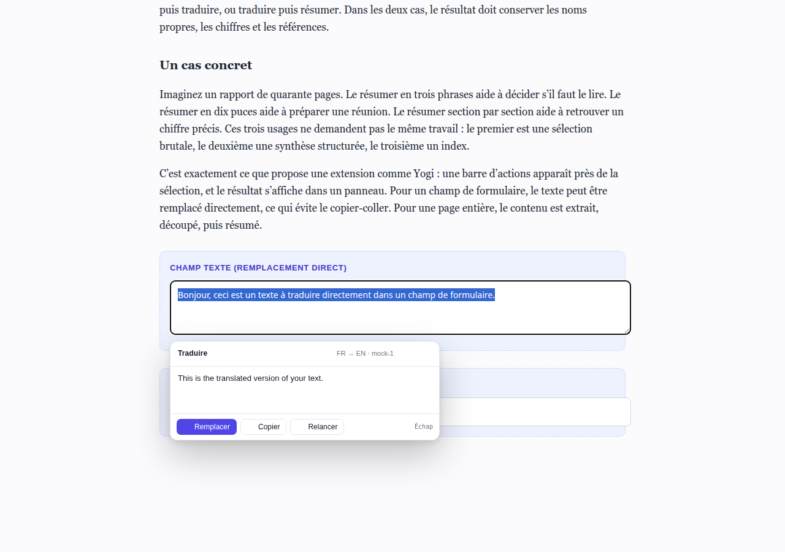
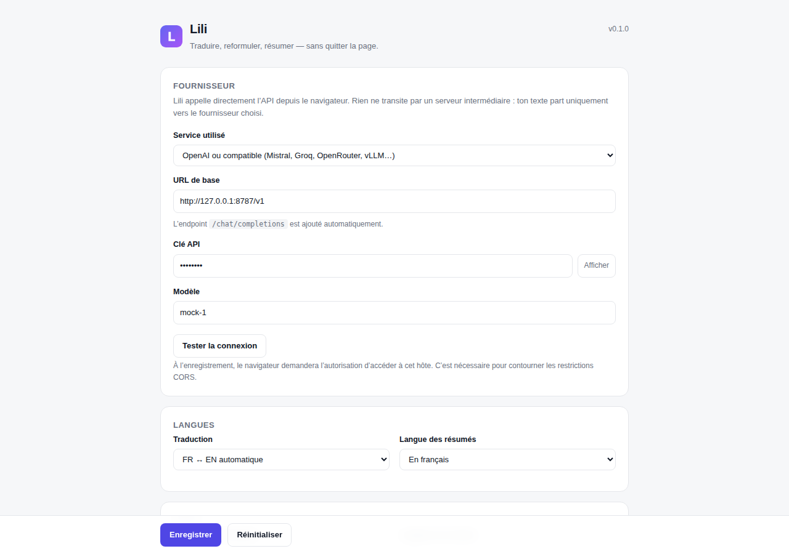
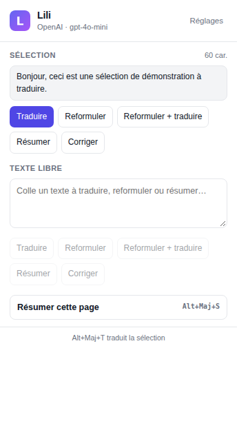

# Lili

Extension Chrome / Firefox pour traiter du texte sans quitter la page : **traduire**, **reformuler**,
**reformuler + traduire**, **résumer** une sélection, **corriger** un texte, ou **résumer la page
entière**.

Un seul code source, deux manifests générés. Aucun serveur intermédiaire : l’extension appelle
directement l’API du fournisseur que tu choisis (OpenAI-compatible, Anthropic ou Ollama).


## Fonctionnalités

| Action | Sur une sélection | Sur un champ texte | Raccourci |
| --- | --- | --- | --- |
| Traduire (FR ↔ EN auto) | oui | **remplace sur place** | `Alt+Maj+T` |
| Reformuler (ton réglable) | oui | **remplace sur place** | `Alt+Maj+R` |
| Reformuler puis traduire | oui | **remplace sur place** | — |
| Résumer | oui | panneau de résultat | `Alt+Maj+D` |
| Corriger orthographe / grammaire | oui | **remplace sur place** | — |
| Résumer la page entière | — | — | `Alt+Maj+S` |

- **Barre flottante** près de la sélection, **menu contextuel** (clic droit), **popup** de l’extension
  (sélection courante, texte collé, ou page entière) et **raccourcis clavier**.
- **Streaming** : la réponse s’affiche au fil de l’eau dans un panneau discret (shadow DOM, aucun
  conflit de style avec la page).
- **Remplacement direct** dans les `input`, `textarea` et zones `contenteditable` (bouton
  « Remplacer », ou automatique via une option). `Ctrl+Z` annule.
- **Résumé de page en map-reduce** : le contenu principal est extrait, découpé, résumé section par
  section, puis fusionné. Les pages longues ne sont pas tronquées silencieusement.
- **Détection de langue FR/EN** pour la traduction automatique (`auto`), ou langue cible imposée.
- Interface et prompts en français, **clair / sombre**, réglages complets.

| Panneau de résultat | Réglages | Popup |
| --- | --- | --- |
|  |  |  |

## Installation

### Chrome / Edge / Brave

```bash
npm run build
```

1. Ouvre `chrome://extensions`.
2. Active **Mode développeur**.
3. **Charger l’extension non empaquetée** → choisis `dist/chrome`.
4. Épingle l’icône, puis ouvre les **Réglages** (clic droit sur l’icône → Options).

> `npm run build:zip` produit aussi `dist/lili-chrome.zip` pour le Chrome Web Store.

### Firefox

1. Ouvre `about:debugging#/runtime/this-firefox`.
2. **Charger un module temporaire** → choisis `dist/firefox/manifest.json`.
3. Les réglages s’ouvrent au premier lancement.

Le chargement temporaire disparaît au redémarrage ; pour un usage durable, passe par
`about:addons` → roue dentée → **Installer un module depuis un fichier** avec le `.zip`
(`npm run build:zip`) signé par Mozilla, ou charge le dossier via un profil de développement.

## Configuration

1. Choisis le **service** : OpenAI/compatible, Anthropic ou Ollama.
2. Renseigne l’**URL de base**, la **clé API** et le **modèle**.
3. Clique **Tester la connexion**, puis **Enregistrer**.

À l’enregistrement, le navigateur demande l’autorisation d’accéder à l’hôte de l’API. C’est
nécessaire pour que la requête ne soit pas bloquée par CORS. Si tu refuses, tout fonctionne encore
si l’API envoie les bons en-têtes CORS.

### Exemples de configuration

| Service | URL de base | Modèle (exemple) |
| --- | --- | --- |
| OpenAI | `https://api.openai.com/v1` | `gpt-4o-mini` |
| Mistral | `https://api.mistral.ai/v1` | `mistral-small-latest` |
| Groq | `https://api.groq.com/openai/v1` | `llama-3.3-70b-versatile` |
| OpenRouter | `https://openrouter.ai/api/v1` | `openai/gpt-4o-mini` |
| vLLM / LiteLLM (local) | `http://localhost:8000/v1` | nom du modèle servi |
| Anthropic | `https://api.anthropic.com` | `claude-3-5-haiku-latest` |
| Ollama | `http://localhost:11434` | `llama3.1:8b` |

**Ollama** : autorise l’origine de l’extension, sinon la requête est refusée :

```bash
OLLAMA_ORIGINS="*" ollama serve
```

### Réglages utiles

- **Traduction** : `FR ↔ EN automatique`, `Toujours vers le français`, `Toujours vers l’anglais`.
- **Langue des résumés** : français ou anglais.
- **Ton** de la reformulation : neutre, professionnel, décontracté, académique.
- **Longueur** du résumé : court, moyen, détaillé.
- **Barre flottante** : afficher/masquer, choisir les actions proposées.
- **Remplacement automatique** : remplace le texte du champ dès la fin du traitement.
- **Limites** : taille maximale d’une sélection et d’une page analysée.

## Utilisation

1. Sélectionne du texte : la barre apparaît au-dessus.
2. Clique une action (ou clic droit → *Traduire / Reformuler / Résumer…*).
3. Le panneau affiche le résultat en streaming :
   - **Remplacer** (champ éditable) — remplace la sélection, `Ctrl+Z` pour annuler ;
   - **Copier** — presse-papiers ;
   - **Relancer** — relance la même demande ;
   - **Échap** — ferme.

Le bouton **Page** de la barre, le popup et `Alt+Maj+S` lancent le résumé de la page. Le popup permet
aussi de traiter un texte collé.

## Architecture

```
src/
├── manifest.base.json       # commun
├── manifest.chrome.json     # service worker MV3
├── manifest.firefox.json    # event page + gecko id
├── background.js            # stockage, menus, raccourcis, streaming, prompts, map-reduce
├── shared/constants.js      # métadonnées des actions (labels, icônes)
├── content/
│   ├── content.js           # sélection, barre, panneau, extraction, remplacement
│   └── styles.js            # CSS injecté via adoptedStyleSheets (shadow DOM)
├── options/                 # page de réglages
└── popup/                   # popup de l’extension
scripts/
├── build.mjs                # dist/chrome + dist/firefox (+ zip)
├── check.mjs                # syntaxe JS + JSON
└── make-icons.py            # icônes PNG
```

**Flux d’une action** : le content script capture la sélection → ouvre un port
`lili-stream` → le background construit le prompt, appelle l’API en SSE et renvoie les deltas → le
panneau les affiche. Le remplacement se fait dans la page, avec les références DOM conservées au
moment de la sélection.

Points techniques :

- Aucun bundler, aucune dépendance npm : les scripts sont chargés tels quels.
- Le background est un script classique, compatible `service_worker` (Chrome) et `scripts`
  (Firefox).
- L’UI vit dans un shadow root : pas de fuite CSS, pas de blocage par la CSP du site
  (`adoptedStyleSheets`).
- Le service worker est maintenu éveillé pendant les appels longs (keepalive + watchdog 90 s).
- Les erreurs HTTP sont traduites en messages actionnables (401, 404, 429, réseau, délai).

## Développement

```bash
npm run icons     # régénère les icônes PNG (Pillow)
npm run check     # node --check sur tous les scripts + validation JSON
npm run build     # dist/chrome + dist/firefox
```

Après une modification, relance `npm run build` puis :
- Chrome : icône **Recharger** dans `chrome://extensions` ;
- Firefox : **Recharger** dans `about:debugging`.

## Confidentialité

- Le texte sélectionné n’est envoyé qu’au fournisseur configuré, au moment où tu déclenches une
  action.
- Aucune télémétrie, aucun serveur maison, aucun compte.
- La clé API est stockée dans `chrome.storage.local` (profil du navigateur), jamais dans le code.
- Les prompts et les réponses ne sont pas journalisés.

## Limites connues

- Les `input` / `contenteditable` situés **dans un shadow DOM** de la page ne sont pas détectés.
- Éditeurs sur canvas (Google Docs, certains IDE web) : la sélection n’est pas accessible.
- Les **iframes** n’ont pas la barre flottante ; le menu contextuel y fonctionne via le texte de
  sélection (sans remplacement).
- Pages internes du navigateur, PDF natifs et Chrome Web Store : injection interdite par le
  navigateur.
- La détection de langue est une heuristique FR/EN ; les autres langues doivent utiliser une cible
  fixe.
- Les très longues pages sont résumées sur les `maxChunks` premières sections (8 par défaut).

## Dépannage

| Symptôme | Piste |
| --- | --- |
| « Accès refusé (401) » | Clé API invalide ou expirée ; vérifie aussi l’URL de base. |
| « Impossible de joindre l’API » | URL erronée, service arrêté, ou autorisation d’hôte refusée : ré-enregistre les réglages et accepte la demande du navigateur. |
| « Endpoint ou modèle introuvable (404) » | L’URL de base doit pointer sur `…/v1` (OpenAI-compatible) ; vérifie le nom du modèle. |
| Ollama répond une erreur réseau | Relance Ollama avec `OLLAMA_ORIGINS="*"`. |
| Pas de barre sur une page | Page interne/PDF, sélection dans une iframe, ou barre désactivée dans les réglages. |
| Rien ne se passe après un rechargement d’extension | Recharge l’onglet : les content scripts ne sont pas réinjectés à chaud. |

## Conventions de développement

- Branches : `main` = stable (releases) ; `dev` = développement et intégration.
- Commits : convention **Gitmoji**, sujet à l’impératif en anglais, corps factuel en puces.
- Code et commentaires en anglais, commentaires courts ; interface, prompts et documentation en
  français.

## Licence

Usage personnel. Adapte et réutilise librement.
